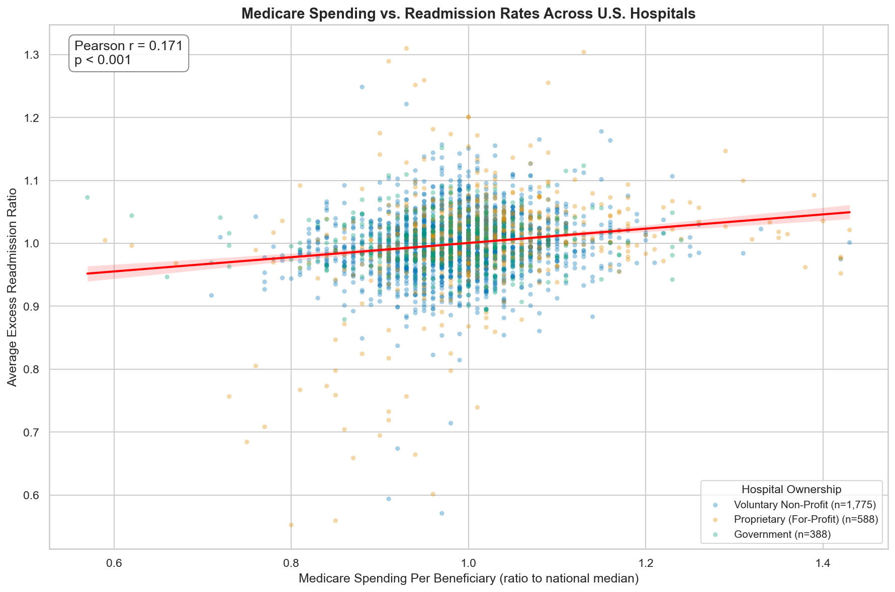
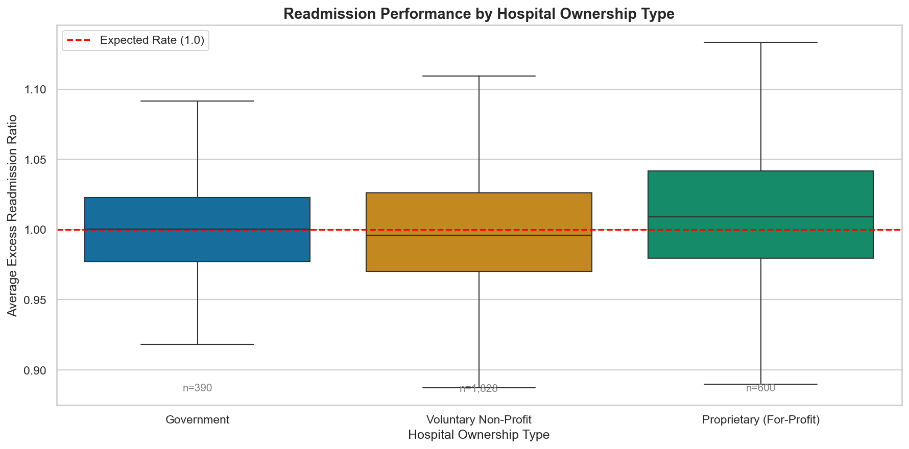
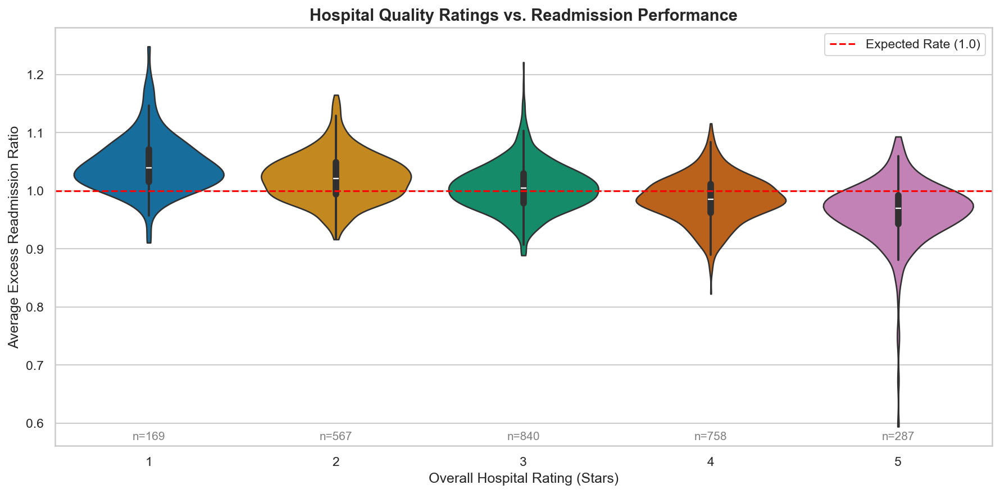

# Healthcare Spending & Hospital Readmissions Analysis

An analysis of 2,818 U.S. acute care hospitals that asks whether hospitals with higher Medicare spending per patient episode have fewer readmissions. It joins three public datasets from the Centers for Medicare & Medicaid Services (CMS) and reports correlations, group comparisons, and a regression with controls.

Short answer: no. Spending and readmission ratios are weakly positively correlated (r = 0.171, n = 2,751), and the association shrinks and then changes sign as controls are added. Details and caveats are below.

## Key Question

> **Do hospitals with higher Medicare spending per episode have fewer patient readmissions?**

## Data Sources

All data is publicly available from the [CMS Provider Data Catalog](https://data.cms.gov/provider-data/).

| Dataset | Description | Source |
|---------|-------------|--------|
| Hospital General Information | Location, hospital type, ownership, and overall star rating | [xubh-q36u](https://data.cms.gov/provider-data/dataset/xubh-q36u) |
| Hospital Readmissions Reduction Program (HRRP) | Excess readmission ratios for 6 conditions at each hospital | [9n3s-kdb3](https://data.cms.gov/provider-data/dataset/9n3s-kdb3) |
| Medicare Spending Per Beneficiary (MSPB) | Hospital spending per episode relative to the national median | [rrqw-56er](https://data.cms.gov/provider-data/dataset/rrqw-56er) |

The numbers in this README come from files downloaded on 2026-11-10. The HRRP file covers discharges from 07/01/2021 to 06/30/2024 and the MSPB file covers 01/01/2024 to 12/31/2024. CMS refreshes these files, so a later run will give slightly different numbers.

## Definitions

- **Excess readmission ratio (ERR):** a hospital's predicted 30-day readmission rate divided by its expected rate for a condition. Above 1.0 means more readmissions than expected for its patients.
- **Average ERR:** the unweighted mean of a hospital's ERRs across the HRRP conditions it reports (between 1 and 6 conditions per hospital). This is the outcome used below.
- **Spending ratio:** the MSPB score. 1.0 means spending per episode equals the national median.

## Methodology

1. **Download:** three CSVs from the CMS Provider Data Catalog API.
2. **Clean:** convert placeholders such as "Not Available" and "Too Few to Report" to missing values, standardize facility IDs, map HRRP measure names to the six conditions, and pivot readmissions to one row per hospital.
3. **Join:** inner join of the three tables on facility ID.
4. **Analyze:** Pearson and Spearman correlations, group means with a Welch t-test and Cohen's d, condition-level summaries, and an OLS regression with controls.

Steps 1 to 3 are in `src/cms_data.py` and are tested in `tests/test_cms_data.py`. Step 4 is in `notebooks/analysis.ipynb`.

## Results

Every number in this section is printed by `notebooks/analysis.ipynb` (Steps 4, 6, and 7).

### Sample

| Step | Hospitals |
|------|-----------|
| Hospital General Information | 5,419 |
| HRRP file, hospitals with at least one reported ERR | 2,833 |
| MSPB file (with a reported score) | 4,626 (2,872) |
| **After inner join of all three** | **2,818** |
| ...with an MSPB score | 2,751 |
| ...with a star rating | 2,621 |
| ...with both | 2,570 |

All 2,818 joined hospitals are acute care hospitals, in 50 states and DC.

### Spending vs. readmission ratio

| Statistic | Value |
|-----------|-------|
| n | 2,751 |
| Pearson r | 0.171 (95% CI 0.134 to 0.207) |
| p-value | 2.0e-19 |
| r squared | 0.029 |
| Spearman rho | 0.167 |

The correlation is positive and statistically significant, but weak. Spending accounts for about 3% of the variance in the average ERR.

### Readmission ratio by ownership type

| Ownership | n | Mean ERR | SD | Median ERR |
|-----------|---|----------|----|------------|
| Voluntary non-profit | 1,828 | 0.9976 | 0.0501 | 0.9959 |
| Proprietary (for-profit) | 600 | 1.0042 | 0.0811 | 1.0091 |
| Government | 390 | 1.0005 | 0.0397 | 1.0005 |

Non-profit vs. for-profit:

| Test | Result |
|------|--------|
| Difference in means (non-profit minus for-profit) | -0.0066 (95% CI -0.0135 to 0.0003) |
| Welch t-test | t = -1.88, df = 754.5, p = 0.061 |
| Cohen's d | -0.11 |
| Mann-Whitney U | p = 1.5e-07 |

The difference in means is small (d = -0.11) and is not significant at the 0.05 level under the Welch t-test. The Mann-Whitney test, which compares the distributions by rank, is significant. The two tests disagree because for-profit hospitals have a much wider spread (SD 0.081 vs. 0.050) and a higher median. A one-way ANOVA across all three groups gives F = 3.12, p = 0.044. The evidence for an ownership difference is weak.

### Readmission ratio by star rating

| Star rating | n | Mean ERR | SD | Median ERR |
|-------------|---|----------|----|------------|
| 1 | 169 | 1.0453 | 0.0481 | 1.0397 |
| 2 | 567 | 1.0230 | 0.0415 | 1.0212 |
| 3 | 840 | 1.0056 | 0.0411 | 1.0042 |
| 4 | 758 | 0.9859 | 0.0399 | 0.9856 |
| 5 | 287 | 0.9642 | 0.0539 | 0.9703 |

n = 2,621 rated hospitals (197 have no rating). Spearman rho between rating and average ERR is -0.443 (p = 1.7e-126). Mean ERR falls at every step, and the gap between 1-star and 5-star hospitals is 0.081. The CMS star rating includes readmission measures as one of its inputs, so part of this relationship is built in.

### Condition-level figures

| Condition | Hospitals with ERR | Mean ERR | Median ERR | SD of ERR | Share with ERR > 1 | Mean predicted readmission rate | r with spending (n) |
|-----------|--------------------|----------|------------|-----------|--------------------|---------------------------------|---------------------|
| Heart failure (HF) | 2,610 | 1.0013 | 0.9982 | 0.0649 | 48.9% | 19.38% | 0.099 (2,555) |
| COPD | 2,318 | 1.0011 | 0.9969 | 0.0460 | 47.2% | 18.00% | 0.051 (2,264) |
| Pneumonia (PN) | 2,700 | 1.0014 | 0.9954 | 0.0663 | 46.8% | 15.60% | 0.131 (2,639) |
| Heart attack (AMI) | 1,732 | 1.0015 | 0.9994 | 0.0667 | 49.5% | 13.42% | 0.123 (1,691) |
| CABG | 877 | 1.0018 | 1.0000 | 0.0966 | 49.9% | 10.68% | 0.068 (866) |
| Hip/knee replacement | 1,444 | 1.0038 | 0.9914 | 0.1558 | 47.8% | 5.49% | 0.092 (1,400) |

Mean ERR is close to 1.0 for every condition. That is by design, since the ERR compares each hospital to a national expectation, so the ERR cannot show which condition has more readmissions. The predicted readmission rate can: it is highest for heart failure (19.4%) and COPD (18.0%) and lowest for hip/knee replacement (5.5%). Hip/knee has the widest spread of ERRs (SD 0.156). The correlation between ERR and spending is positive for all six conditions, between 0.05 and 0.13. The p-values are below 0.001 for HF, PN, AMI, and hip/knee, 0.015 for COPD, and 0.046 for CABG.

### Robustness check: regression with controls

OLS with the average ERR as the outcome, HC3 robust standard errors, and the same 2,570 hospitals (those with both a spending score and a star rating) in every model.

| Model | Spending coefficient | Robust SE | 95% CI | p-value | R squared | n |
|-------|----------------------|-----------|--------|---------|-----------|---|
| 1. Spending only | 0.0864 | 0.0109 | 0.0651 to 0.1078 | < 0.001 | 0.021 | 2,570 |
| 2. + ownership type + state fixed effects | 0.0289 | 0.0133 | 0.0028 to 0.0550 | 0.030 | 0.127 | 2,570 |
| 3. + ownership type + state fixed effects + star rating | -0.0309 | 0.0123 | -0.0549 to -0.0069 | 0.012 | 0.288 | 2,570 |

The spending coefficient does change. It drops by about two thirds when ownership and state are added, and it becomes slightly negative when star rating is added as well. In model 3, a 0.10 higher spending ratio goes with a 0.003 lower average ERR, which is small next to the ERR's standard deviation of 0.048 in this sample.

Other coefficients in model 3 (reference groups: government ownership, 1-star rating): for-profit 0.0077 (p = 0.007), non-profit 0.0042 (p = 0.068), and star ratings 2 to 5 at -0.0216, -0.0387, -0.0577, and -0.0813 (all p < 0.001).

Two cautions on reading this:

- Star rating is a questionable control. It is partly computed from readmission measures, so model 3 conditions on something close to the outcome. Model 2 is the cleaner adjusted estimate.
- The result depends on the sample. On all 2,751 hospitals with a spending score (rated or not), the spending-only coefficient is 0.1133 (SE 0.0141) and the coefficient with ownership and state is 0.0736 (SE 0.0171, p < 0.001).

Taken together: the positive raw association is partly explained by state and ownership, and its sign is not robust. The data does not support the claim that higher spending goes with fewer readmissions, and it does not establish the opposite either.

## Limitations

- **Correlational.** This is a cross-sectional, hospital-level analysis. It cannot show that spending causes any change in readmissions.
- **Case mix.** Both measures are risk-adjusted by CMS, but adjustment is imperfect. Hospitals that treat sicker or lower-income patients may have both higher spending and more readmissions.
- **Hospital size.** Volume, teaching status, and bed count are not controlled for. Size plausibly affects both spending and how stable a hospital's ratios are.
- **Region.** State fixed effects absorb state-level differences, but not differences within a state such as urban vs. rural markets.
- **Outcome definition.** The average ERR is an unweighted mean over whichever conditions a hospital reports (1 to 6), so it is not the same quantity for every hospital, and it does not weight by discharge volume.
- **Selection.** Hospitals without a reported ERR or MSPB score are excluded, which removes critical access hospitals and hospitals with too few cases to report. Results describe acute care hospitals with enough volume to be measured.
- **Different time windows.** Readmissions cover July 2021 to June 2024. Spending covers calendar year 2024.
- **Star rating overlap.** The star rating includes readmission measures, which affects both the star rating table and model 3.
- **Multiple comparisons.** Several tests are reported with no correction. P-values near 0.05 should be read with that in mind.

## Visualizations







## Project Structure

```
healthcare-spending-analysis/
├── notebooks/analysis.ipynb   # analysis, figures, statistics, regression
├── src/cms_data.py            # download, cleaning, and join functions
├── tests/test_cms_data.py     # pytest tests for cleaning and join logic
├── figures/                   # charts written by the notebook
├── data/                      # CSVs downloaded at run time (not committed)
├── pytest.ini
└── requirements.txt
```

## Tech Stack

- Python 3
- pandas, numpy: data cleaning and joins
- scipy, statsmodels: statistical tests and regression
- matplotlib, seaborn: charts
- plotly: state map (the notebook falls back to a matplotlib bar chart when static image export is not available)
- pytest: tests
- Jupyter Notebook

## How to Run

```bash
git clone https://github.com/aboodshurbjy/healthcare-spending-analysis.git
cd healthcare-spending-analysis
pip install -r requirements.txt

# run the tests
pytest

# run the analysis
jupyter notebook notebooks/analysis.ipynb
```

The data files are downloaded by the notebook on first run. No manual download is needed.

## Author

Abood Shurbjy, Chemical & Biomolecular Engineering, University of Pennsylvania

## License

This project is licensed under the MIT License. See [LICENSE](LICENSE) for details.
